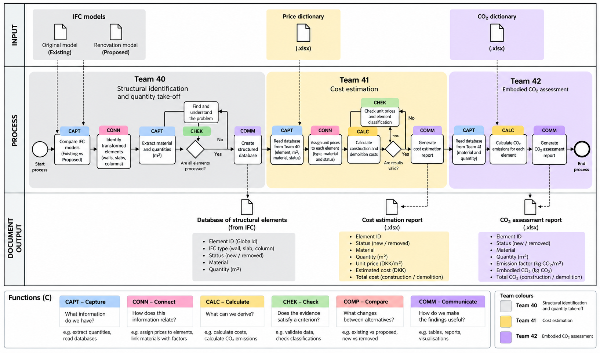

# A4 – Which renovation option costs the planet (and the budget) less?

**Group 42 · Focus area: Build (BLD) · Role: Managers**

We built this tool together with Teams 40 and 41 in the "manager / analyst" format:

| Team | Part | Folder |
|---|---|---|
| 40 | Finds what changes between two models and groups it, with quantities | `model_changes/` |
| 41 | Puts a price (DKK) on every group | `cost_estimate/` |
| **42 (us)** | **Embodied carbon (kgCO₂e)**, plus the **integration**: the runner, the final report, the tests and the IDS | `embodied_carbon/`, `runall.py`, `settings.py`, `project_report/`, `tests/`, `information_requirements.ids` |

The full list of the functions we wrote is in [What we (Team 42) wrote](#what-we-team-42-wrote).

---

## About the tool

### The problem

You have an existing building and several renovation proposals. Which one is better? To answer
that you need three things for each proposal:

- what actually changes,
- how much CO₂ that change embodies,
- how much it costs.

Today that means opening every model, counting elements by hand, copying quantities into an LCA
tool and a spreadsheet, and repeating everything each time the design changes. It's slow, and
it's easy to forget an element or count one twice.

**Our claim:** given the existing model and any number of proposed models, the tool tells you,
for each proposal, *what changes, how many kgCO₂e and how many DKK*. Anything it can't work out is
listed for a person to fill in by hand, so nothing is silently counted as zero.

### Where we found it

In our Building 308 work (A2) we had the existing building (`B308X.ifc`) and several structural
proposals from different authors (`26-06`, `26-09`, …). Comparing them by hand turned out to be
the bottleneck. It also showed the real-life mess:

- the models come from different Revit files, so they share no GlobalIds;
- they sit in different coordinates;
- they name the same material in different ways.

### What it does



*Our process diagram from A2, which is the plan we built the tool from.* Three things changed
while building it:

- Teams 41 and 42 both read Team 40's groups **in parallel**, not one after the other, so a
  missing price never blocks the CO₂ result.
- Quantities are in **m³** (with m² and m kept for prices per area or length), not only m².
- There is one extra step at the end, `project_report`, that joins the three outputs into one
  Excel file with a **Manual review** list.

1. **Team 40 – what changes.** Reads the beams, columns, slabs and exterior walls of both models.
   It pairs up elements that are the same (same class, material, section and quantities); what's
   left over is `new` or `removed`. Similar elements are grouped (for example "40 × HEB300 S355"),
   with the count, length, area and **volume**.
2. **Team 42 – embodied carbon (us).** For each group:
   - a material "translator" turns names like `Stål S355`, `Concrete C30/37` or `Limtræ GL30`
     into one of 23 categories;
   - layered walls and slabs are split by layer thickness, and insulation, membranes and
     finishes count as zero;
   - m³ × factor from **BR18 Tabel 7 (2025)**, the Danish generic data also used in LCAbyg.
     New elements count production + end of life (A1–A3 + C3–C4). Removed elements count
     demolition only (C3–C4).
3. **Team 41 – cost.** The same categories × Danish reference prices (DKK per m³, m² or m), with
   a separate demolition price for removed elements.
4. **Report – putting it together (us).** One Excel file that anyone can open, without IFC software.

### What you get

`results/project_results.xlsx`, which grows every time you run the tool:

- **Overview:** one row per proposal with the volume changed, kgCO₂e, DKK and whether it's
  complete. It's ranked from the lowest CO₂ to the highest.
- **Manual review:** every group the tool couldn't calculate (unknown material, missing price,
  incomplete data), with empty columns for a person to type the value. Re-running the tool
  keeps what was typed.
- **One sheet per proposal:** the detail of every group.

Each team also writes its own `result.json` in a new `run-<time>` folder every time, so earlier
runs are never overwritten. This is how the course template does it.

### Libraries we use

| Library | What it does in the tool |
|---|---|
| [IfcOpenShell](https://ifcopenshell.org) | Opens the IFC models and reads the elements, materials, properties, quantities and geometry |
| [pandas](https://pandas.pydata.org) | Holds the elements and groups as tables, and does the grouping, sums and joins between teams |
| [openpyxl](https://openpyxl.readthedocs.io) | Writes and formats the Excel files |
| [ifctester](https://pypi.org/project/ifctester/) | Checks a model against our IDS (optional) |

### How to run it

```
pip install -r requirements.txt     # once, in a terminal inside the A4 folder
python runall.py                    # with the IFC files in A4/models/
```

Put the existing building (with `B308X` in its file name) and the proposals in `models/`.
The result is `results/project_results.xlsx`.

### Results with the course models

Existing building `B308X.ifc` (structural elements only):

| Proposal | New m³ | Removed m³ | kgCO₂e | DKK | Groups for manual review |
|---|---|---|---|---|---|
| 26-06-D-STR | 3,634 | 2,123 | 1,082,173 | ≈ 30.7 M | 18 of 165 (no price) · 9 (no CO₂) |
| 26-09-D-STR | 1,393 | 2,156 | 592,165 | ≈ 7.3 M | 47 of 154 (no price) · 8 (no CO₂) |

### Limitations (being honest)

- **Same element, different name.** Team 40 only pairs elements whose material names match.
  When the proposal re-models an existing element with another material name, it counts as
  removed + new. The clearest case is the 600 mm ground slab in 26-06: it's in both models, in
  the same place, and is even named "EKSISTERENDE" (existing), yet it adds about 513 t CO₂e and
  9 M DKK. The numbers above are therefore an **upper bound**. Details and a suggested fix are in
  [`TEAM40_REVIEW.md`](TEAM40_REVIEW.md). An earlier version that matches by **position** (it
  aligns the models automatically) is kept in `model_changes/src/position_matching.py`.
- **Prices are references, not quotes.** They come from public Danish sources and are all marked
  `verified: no`. Steel has no price yet, and it's listed in Manual review, not counted as 0.
  Sources: [`PRICE_GUIDE.md`](PRICE_GUIDE.md).
- **Generic CO₂ data.** Concrete without a strength class is taken as C25/30. In-situ concrete
  adds 100 kg of rebar per m³. Precast and hollow-core elements are treated as in-situ concrete,
  which slightly overestimates them. Module D is not included.
- **Layered elements.** These are only split by layer when the material text includes the layer
  thicknesses. Team 40's current output doesn't include them, so those groups go to Manual review.
- **Scope.** Structural elements only (beams, columns, slabs, exterior walls). Volumes come from
  the model's quantities or geometry and have not been checked against a Revit takeoff.

---

## Advanced Building Design

**Stage.** Mainly **Stage B**, when the team has the existing building and is comparing renovation
or structural options. CO₂ and cost help choose between them at that point. It's also useful in
**Stage C**, to re-check the chosen option as the model develops: just drop the new version
into `models/` and run it again.

**Who would use it:**

- **Structural engineers**, to see how much material their option adds or removes.
- **Sustainability / LCA**, to get a quick embodied-carbon check of each option against BR18
  before doing the full LCAbyg calculation.
- **Project management and cost**, to get an early budget for each option and a list of what
  still has to be priced.
- **Architects / the client**, to compare options on one Excel sheet without opening IFC.

**What the model needs** (checked by the IDS below):

- `IfcBeam`, `IfcColumn`, `IfcSlab` and `IfcWall` with a **material**. A real name helps (for
  example `Concrete C30/37` or `Steel S355`). Layered walls and slabs work best as a material
  layer set with thicknesses.
- Walls with **`Pset_WallCommon.IsExternal`**, because Team 40 compares exterior walls. Without
  it, the tool guesses from the wall name.
- **Base quantities** (`Qto_…BaseQuantities` → `NetVolume`). These are optional: without them the
  volume is calculated from the geometry (slower, and flagged as an estimate).
- The existing building and the proposals can come from different files. Same GlobalIds are not
  required.

### IDS

[`information_requirements.ids`](information_requirements.ids) (IDS 1.0, works for IFC2X3, IFC4
and IFC4X3) has three checks: material on structural elements, `IsExternal` on walls, and a
positive `NetVolume` when it's exported.
To check a model: `python -m ifctester information_requirements.ids models/<model>.ifc -r Console`

| Model | Material | IsExternal | NetVolume |
|---|---|---|---|
| B308X.ifc | ✅ 366/366 | ✅ 149/149 | ✅ |
| 26-06-D-STR.ifc | ✅ 800/800 | ✅ 93/93 | ✅ |
| 26-09-D-STR.ifc | ✅ 783/783 | ✅ 22/22 | ✅ |
| tests/models/existing.ifc | ✅ 10/10 | ❌ 0/4 | ✅ |

The test model fails `IsExternal`, and that's exactly where Team 40 had to guess from the wall name.

---

## What we (Team 42) wrote

The course template naming is `TYPE_ELEMENT`: CAPT = read, CONN = connect or translate,
CALC = calculate, CHEK = check, COMM = communicate. Every analysis has one primary **C** function.

**`embodied_carbon/src/main.py`** – primary **`CALC_CO2`**

| Function | What it does |
|---|---|
| `CAPT_GROUPS` | Reads Team 40's groups (list, DataFrame or Excel) |
| `CAPT_CO2DATA` | Reads the rules and factors from `data/co2_database.xlsx` |
| `CONN_NAME`, `CONN_MATERIAL` | The material translator: name → CO₂ category |
| `CONN_LAYERS` | Splits a layered material by layer thickness |
| `CALC_VOLUME` | Picks the volume of a group |
| `CALC_FACTOR` | kgCO₂e/m³ for a category, new or removed, with rebar |
| **`CALC_CO2`** | m³ × factor for every group, with a reason when it can't |
| `CHEK_CO2` | Lists the groups without CO₂ |
| `COMM_CO2`, `COMM_SHEETS`, `COMM_EXCEL` | Summary tables and the `CO2_*` Excel sheets |
| `analyse` | Entry point called by the runner |

`embodied_carbon/data/build_co2_database.py` builds the database from BR18 Tabel 7 (2025, via
[ocni-dtu/table7](https://github.com/ocni-dtu/table7), MIT): 23 categories and 30 name rules.

**Integration**

| File | Functions |
|---|---|
| `runall.py` | `CAPT_MODELS` (finds the existing model and the proposals in `models/`), `CONN_TEAM40` (adapter: calls Team 40 with the options it accepts and fills what the others need), `run_variant`, `save_result` (unchanged from the template), `main` |
| `project_report/src/main.py` | `CONN_TEAMS` (joins quantities + CO₂ + cost), `CONN_REVIEW` (makes sure Team 40's incomplete elements reach Manual review), `CHEK_COMPLETE`, `CALC_OVERVIEW`, `COMM_WORKBOOK` (Overview / Manual review / per-proposal sheets, keeps manual entries) |
| `settings.py` | Models folder, original-file name, options |
| `tests/test_tool.py` | 11 tests: known results, missing data never becomes 0, JSON output, Team 40 contract, models folder |
| `information_requirements.ids` | The IDS above |

Team 40's code (`model_changes/src/main.py`) and Team 41's code (`cost_estimate/`,
`tests/test_cost.py`, `PRICE_GUIDE.md`) are included **unchanged** from their repositories:
[BLD_26_40](https://github.com/ANANDO02/BLD_26_40) and
[BLD_26_41](https://github.com/ivannaloria/BLD_26_41).

## Folder structure

```text
A4/
  README.md                     this file
  settings.py                   models folder + options
  runall.py                     runs everything (our "main")
  requirements.txt
  information_requirements.ids  IDS: can a model be run by the tool?
  models/                       put the IFC files here (not on GitHub)
  model_changes/src/main.py     Team 40
  embodied_carbon/              Team 42 – src/main.py + data/co2_database.xlsx
  cost_estimate/                Team 41 – src/main.py + data/cost_database.xlsx
  project_report/src/main.py    Team 42 – final Excel
  results/                      Excel output (created when you run)
  tests/                        test models + tests
  docs/TECHNICAL.md             function-by-function details
  IMG/                          A2 process diagram
  CHANGELOG.md                  what changed and when
  TEAM40_REVIEW.md, PRICE_GUIDE.md
```
